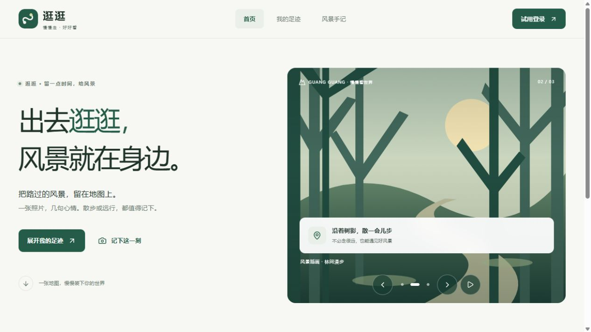
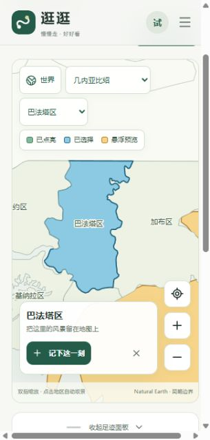
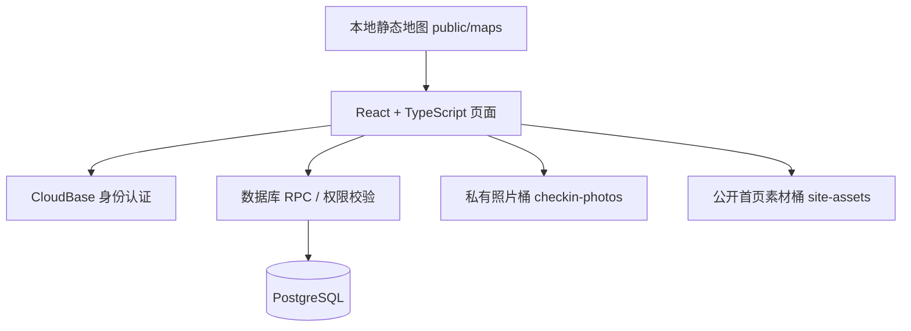

<div align="center">


# 逛逛 · GuangGuang

**把路过的风景，留在地图上。**

一张照片，几句心情。一张属于自己的世界地图。

[界面预览](#界面预览) · [功能介绍](#功能介绍) · [本地运行](#本地运行) · [参与贡献](CONTRIBUTING.md)

React 19 · TypeScript · Vite · CloudBase · PostgreSQL

</div>



## 为什么做逛逛

生活忙碌的时候，我们容易忘记自己见过的风景。

逛逛希望让记录变得轻一点：不必写一篇游记，也不必等到下一次远行。留下路边的晚霞、旅行中的一张照片，再回到地图上看看自己走过的地方。

本项目通过 AI 辅助开发逐步实现，是一个持续迭代的个人风景记录 Web 应用。

> **当前阶段：个人地图与记录功能已实现，正在整理开源版本。**
> 社区地图、公开分享和浏览他人的打卡属于后续规划。
> 请配置自己的 CloudBase 环境。开源目录已补基础表迁移和管理员初始化示例；全新云环境的端到端验收仍待完成。

## 界面预览

| 桌面首页 | 手机地图 |
| --- | --- |
| 风景轮播支持自动播放、暂停和手动切换。 | 选择国家和省级地区，放大查看自己的足迹。 |
|  |  |

截图来自 2026 年 10 月的实际开发验收，展示当时的界面；首页插画为展示素材，不代表用户真实打卡。当前界面可能随版本调整。

## 功能介绍

| 功能 | 当前支持 |
| --- | --- |
| 个人地图 | 世界地图、国家和省级地区选择、缩放、已点亮与选中状态区分 |
| 风景记录 | 照片、文字、地点和日期；列表与详情查看 |
| 地图首图 | 有坐标的记录在地图上展示第一张照片，点击进入详情 |
| 登录与注册 | 保留账号密码入口；邮箱验证码登录、注册和找回密码流程 |
| 首页轮播 | 自动播放、手动切换、暂停；页面后台和减少动态效果时暂停 |
| 内容管理 | 管理员编辑首页文案、图片、排序、启用状态和播放间隔；草稿与发布分离 |
| 权限控制 | 云端校验记录归属和管理员权限；个人照片与首页公开素材分桶存放 |

邮箱功能依赖 CloudBase 的认证与邮件配置。找回密码的真实邮件完整流程、手机真机完整编辑发布流程仍需补充验收。历史自动化测试通过，不等同于所有设备和线上流程均已覆盖。

### 一次记录如何发生


## 技术与结构

前端负责地图和页面交互；CloudBase 提供身份认证、PostgreSQL、对象存储和静态托管。核心记录与内容管理通过数据库 RPC 和权限策略执行。



地图使用随项目提供的简略数据，当前个人地图不要求商业地图 API Key。它用于风景记录，不提供道路导航或街道级地图。

```text
src/
  components/          地图、轮播、导航和通用界面
  pages/               首页、地图、记录、登录与管理页面
  services/            认证、记录与首页内容服务
  context/             登录状态
  utils/               CloudBase 初始化等工具
public/
  images/              首页素材和标志
  maps/                国家、省级地图与来源说明
cloudbase/migrations/  数据库变更、RPC 与权限策略
tests/                 地图模型、单元与组件测试
docs/                  部署说明、截图与公开检查记录
```

仓库保留部分模板示例，包括 Agent 页面，它们不属于当前已完成的核心产品功能。旧账号、云端登录缓存、私人配置、历史开发文档及依赖本机路径的脚本未纳入开源目录。

## 本地运行

### 1. 准备环境

- Node.js **24**（项目历史验证环境）和 npm。
- 下载仓库代码，或使用 Git 克隆到本地。
- 如需真实登录、上传和保存，准备自己的 CloudBase 环境及 PostgreSQL / PG 存储。

进入项目根目录：

```bash
npm ci
```

### 2. 配置环境变量

将根目录的 `.env.example` 复制为 `.env.local`，填入自己的配置：

```dotenv
VITE_CLOUDBASE_ENV_ID=your-cloudbase-env-id
VITE_PUBLISHABLE_KEY=your-publishable-key
VITE_CLOUDBASE_REGION=ap-shanghai
```

`VITE_` 开头的变量会进入浏览器构建产物，**不要放 SecretKey、数据库密码或管理凭证**。Publishable Key 的访问范围仍需要云端权限策略约束。

环境和地域由上述变量读取，不再回退到维护者的环境。若需要本地认证代理，在 .env.local 设置 CLOUDBASE_AUTH_ORIGIN 为自己的 HTTPS 托管源站（不带路径）。未配置时不开启代理。

将 cloudbaserc.example.json 复制为 cloudbaserc.json 并替换环境 ID。按 [部署说明](docs/SETUP.md) 在自己的 CloudBase PostgreSQL 空环境初始化数据库、认证和存储，再按示例设置管理员。

新增基础表迁移只用于新环境，不能重复执行到已有生产库。首次云端安装仍需实测，不能视为已验证的一键部署。

### 3. 启动前端

```bash
npm run dev
```

浏览器打开 **http://127.0.0.1:5174/**。端口固定为 5174，若被占用请先处理冲突。

| 页面 | 地址 |
| --- | --- |
| 首页 | `/#/` |
| 登录 | `/#/login` |
| 我的足迹 | `/#/map` |
| 风景记录 | `/#/checkin` |
| 新增记录 | `/#/checkin/new` |
| 首页内容管理 | `/#/admin` |

首页带有内置展示内容；完整记录、登录和管理功能依赖后端。进入管理地址本身不会授予管理权限。

Windows PowerShell 若拦截 npm 脚本，可使用 `npm.cmd` 执行同一命令。

## 检查与构建

```bash
npm test
npm run build
npm run preview
```

- `npm test`：地图模型测试、Vitest 单元/组件测试及测试代码类型检查。
- `npm run build`：TypeScript 检查与生产构建，输出到 `dist/`。
- `npm run preview`：本机预览构建产物，以终端打印的地址为准。
- `npx eslint src/`：只检查代码；项目的 `npm run lint` 会自动修改部分文件。

整理版本的检查结果见 [发布检查记录](docs/OPEN_SOURCE_CHECKLIST.md)。本地测试不需要真实账号，不会修改云端数据；新云环境的端到端测试需由部署者单独完成。

## 部署

完成自己的后端配置后，构建并将 `dist/` 内容上传到 CloudBase 静态托管。项目使用 HashRouter，路由形式为 `/#/map`。

现有项目部署到 `guangguang` 子目录时，CLI 操作形式如下，必须替换环境 ID：

```bash
npx tcb login
npx tcb hosting deploy dist guangguang -e YOUR_ENV_ID --verify
```

`guangguang` 不带前导斜杠。根目录部署和其他路径需按自己的环境确认。历史发布另外执行了素材白名单、配置泄漏检查与文件哈希核对；普通 `dist` 上传并不自动包含这些检查。

开发者应自行配置认证域名、邮件发送、数据库权限和存储权限。云资源费用由部署者承担。源码仓库不提供共享生产账号或共享后端。

## 后续计划

- [ ] 提供经过空环境验证的初始化迁移和管理员设置流程。
- [x] 配置去个人化与 MIT 声明。
- [ ] 首次 GitHub 公开发布。
- [ ] 补充更多手机真机测试和操作演示。
- [ ] 社区地图与地区风景浏览。
- [ ] 用户主动选择公开分享，以及相应的内容治理能力。

## 参与贡献

欢迎提交问题、复现步骤或小范围改进。开始前请阅读 [贡献指南](CONTRIBUTING.md)。

涉及权限绕过、账号或照片泄漏的问题，请遵循 [安全说明](SECURITY.md)，不要把真实凭证或个人资料贴到公开 Issue。

## 素材与许可证

项目代码采用 [MIT License](LICENSE)，版权署名为 GuangGuang contributors。允许使用、修改和分发，包括商业使用；使用者需保留版权和许可声明。

上游 CloudBase 声明保留在 [licenses/](licenses/CloudBase-AI-ToolKit-MIT.txt)。第三方地图、摄影、依赖库保留各自许可，详见 [素材来源说明](THIRD_PARTY_NOTICES.md)。本项目许可证不会改变第三方素材的权利。

首次上传前请阅读 [发布检查记录](docs/OPEN_SOURCE_CHECKLIST.md)。

